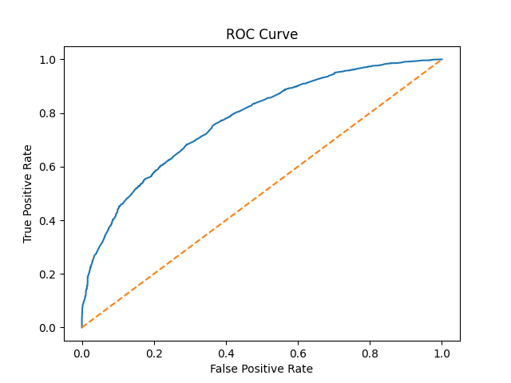
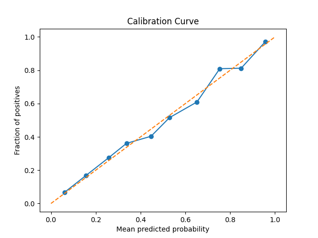

# Credit Risk & Loan Default Predictor

An end-to-end machine learning project that predicts the probability that a loan applicant will default. It includes synthetic data generation, exploratory data analysis, model training and calibration, model interpretability with SHAP, evaluation artifacts, and an interactive Streamlit dashboard.

## Project Overview

The project uses a synthetic portfolio of 20,000 loan applications to demonstrate a credit-risk modeling workflow. Each application contains demographic, employment, loan, debt, credit, and category features. The target is `default`, where:

- `0` = the applicant did not default
- `1` = the applicant defaulted

A held-out test set of 4,000 applications is used to evaluate the final calibrated model.

**Note:** This project is for educational and portfolio purposes only. It uses synthetic data and must not be used as the basis for real lending decisions.

## Key Features

- Generates a reproducible synthetic loan dataset
- Compares logistic regression, decision tree, random forest, and XGBoost
- Handles missing values and scales numeric features
- Encodes categorical features safely for unseen categories
- Addresses class imbalance with balanced class weights
- Calibrates the selected model's predicted probabilities
- Provides ROC, precision-recall, calibration, and SHAP analysis
- Offers a browser-based default-risk assessment dashboard

## Model Summary

The notebook compares four candidate classifiers using stratified 80/20 train-test splitting. Logistic regression achieved the best validation ROC-AUC and was selected as the base estimator. A calibrated five-fold cross-validation wrapper was then fitted with isotonic calibration.

| Metric | Holdout Result |
| --- | ---: |
| ROC-AUC | 0.7722 |
| PR-AUC | 0.6708 |
| Accuracy | 0.732 |
| Default precision | 0.655 |
| Default recall | 0.519 |
| Default F1-score | 0.579 |

At a default decision threshold of `0.5`, the test set produced:

| | Predicted No Default | Predicted Default |
| --- | ---: | ---: |
| **Actual No Default** | 2,189 | 388 |
| **Actual Default** | 685 | 738 |

### Risk Interpretation

The Streamlit dashboard converts the model probability into three presentation bands:

- `< 20%`: low risk
- `20% to < 50%`: medium risk, manual review recommended
- `>= 50%`: high risk

These bands are UI guidance only and are not regulatory risk bands or approval thresholds.

## Evaluation Visualizations

### ROC Curve



### Calibration Curve



### SHAP Summary


## Dataset

The primary project dataset is `data/raw/loan_applications.csv`. It contains 20,000 rows and 15 columns.

| Column | Type | Description |
| --- | --- | --- |
| `applicant_id` | Integer | Unique synthetic applicant identifier |
| `age` | Integer | Applicant age |
| `annual_income` | Float | Annual income in USD |
| `employment_years` | Integer | Years of employment |
| `home_ownership` | Category | `RENT`, `OWN`, or `MORTGAGE` |
| `loan_amount` | Integer | Requested loan amount in USD |
| `loan_term_months` | Integer | Loan term: 12, 24, 36, 48, or 60 months |
| `loan_purpose` | Category | Loan purpose category |
| `credit_score` | Integer | Credit score from 300 to 849 |
| `existing_debt` | Float | Existing debt in USD |
| `debt_to_income` | Float | Existing debt divided by annual income |
| `loan_to_income` | Float | Loan amount divided by annual income |
| `num_late_payments_2yr` | Integer | Late payments in the previous two years |
| `num_open_credit_lines` | Integer | Number of open credit lines |
| `default` | Integer | Target variable |

The synthetic default process assigns higher risk to higher debt-to-income ratios, higher loan-to-income ratios, lower credit scores, and more late payments. It includes noise and is intentionally not a representation of real applicant behavior.

The 35.58% positive class rate is retained from the original synthetic data. The base model training uses balanced class weights; the 20% test set is stratified.

## Project Structure

```text
credit-risk/
├── app.py                              # Streamlit dashboard
├── eda.ipynb                           # EDA, training, evaluation, and SHAP
├── gene_synthetic_data.py             # Synthetic dataset generator
├── loan_data.csv                       # Separate source dataset
├── README.md
├── data/
│   └── raw/
│       ├── loan_applications.csv       # 20,000-row model dataset
│       ├── test_set.csv                # 4,000-row evaluation dataset
│       ├── roc_curve.png
│       ├── calibration_curve.png
│       └── shap_summary.png
├── scripts/
│   └── inspect_model.py                # Model load diagnostics
└── src/
    └── models/
        └── credit_risk_model.pkl       # Calibrated fitted pipeline
```

## Setup

Python 3.10 is recommended because the saved pipeline was generated in a Python 3.10 environment.

From the project root:

```powershell
py -3.10 -m venv .venv
.\.venv\Scripts\Activate.ps1
python -m pip install --upgrade pip
python -m pip install pandas numpy scikit-learn==1.7.1 joblib streamlit plotly shap xgboost matplotlib seaborn jupyter
```

Pinning `scikit-learn==1.7.1` is recommended to match the version used when the bundled pickle was created. Loading a scikit-learn pickle with a different version can produce compatibility warnings or errors.

## Running the Dashboard

Start the Streamlit app from the project root:

```powershell
streamlit run app.py
```

Open the local URL printed in the terminal, typically `http://localhost:8501`.

Enter applicant details and select **Assess Risk** to view:

- Predicted default probability
- Low, medium, or high-risk label
- Gauge visualization
- A simple approval-review recommendation

## Regenerating the Synthetic Data

To generate a fresh 20,000-row dataset:

```powershell
python gene_synthetic_data.py
```

The script uses NumPy seed `42`, writes to `data/raw/loan_applications.csv`, and prints the generated default rate.

## Retraining and Evaluating

Open the notebook:

```powershell
jupyter notebook eda.ipynb
```

Run the modeling cells to:

1. Load `data/raw/loan_applications.csv`
2. Split the data into stratified train and test sets
3. Fit preprocessing pipelines
4. Compare candidate models
5. Calibrate the best model
6. Save `src/models/credit_risk_model.pkl`
7. Create `data/raw/test_set.csv`
8. Produce evaluation and SHAP artifacts

## Model Pipeline

The serialized model is a `CalibratedClassifierCV` wrapping a scikit-learn pipeline.

The preprocessing stage contains:

- Median imputation and standardization for numeric features
- Most-frequent imputation and one-hot encoding for categorical features
- `handle_unknown="ignore"` so unseen categories do not break prediction

The base classifier is an L2-regularized logistic regression model with balanced class weights. The calibration wrapper uses isotonic calibration with five-fold cross-validation.

## Model Diagnostics

Check whether the saved model can be loaded in the active environment:

```powershell
python scripts\inspect_model.py
```

The script reports the installed scikit-learn version, model load status, and version-like strings found inside the pickle.

## Reproducibility

- Synthetic data seed: `42`
- Train-test random state: `42`
- Train-test split: 80/20 stratified
- Random forest: 400 estimators
- XGBoost: 400 estimators, max depth 5, learning rate 0.05
- Logistic regression: maximum 1,000 iterations
- Calibration: isotonic, five-fold

## Limitations

- The data is synthetic, balanced in aggregate across neither features nor outcomes, and may contain unrealistic correlations.
- A 0.5 prediction threshold optimizes neither profit nor false-negative/false-positive cost.
- SHAP explanations describe model behavior, not causality.
- Calibration quality and discrimination may degrade under data drift.
- The dashboard does not replace underwriting policy, legal review, fairness assessment, or human judgment.
- The separate `loan_data.csv` file uses a different schema and is not the primary input for the Streamlit app or synthetic modeling pipeline.
